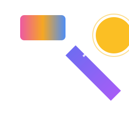

<div align="center">
  
  <h1>CodeForge AI</h1>
  <p><strong>A local-first, open-source AI coding assistant.</strong><br/>
  Chat with any Ollama model (or your own OpenRouter key), import whole projects for code-aware answers, and keep every byte on your machine.</p>
  <p><em>Screenshots & demo GIF land with the v1.0 assets.</em></p>
</div>

---

## Why CodeForge AI?

Commercial AI coding assistants are expensive and ship your code to someone else's cloud. CodeForge runs entirely on hardware you control: models execute locally through [Ollama](https://ollama.ai), conversations live in a local SQLite file, and there is no telemetry — not even an account. One-click start, keyboard-first UI, project-aware retrieval, and streaming answers that render code with syntax highlighting and copy buttons.

## Quick start (3 commands)

```bash
# 1. Backend deps (Python 3.10+; creates ./venv)
python3 -m venv venv && source venv/bin/activate && pip install -r src/backend/requirements.txt

# 2. Frontend deps
cd frontend && npm install && cd ..

# 3. Run everything (Ollama check + backend :8001 + UI :3000)
./start.sh
```

Then open **http://localhost:3000**. You need at least one chat model in Ollama (`ollama pull qwen2.5:7b`, or any other — CodeForge auto-detects whatever `ollama list` shows). Full guide: [docs/QUICKSTART.md](docs/QUICKSTART.md).

## Features

| Area | What you get |
|---|---|
| **Chat** | Streaming responses (SSE), Markdown + syntax-highlighted code with copy buttons, regenerate, dark/light theme |
| **Models** | Any local Ollama model; OpenRouter BYOK for cloud models (opt-in, key stored locally); system prompt & temperature controls |
| **Project awareness** | Import a folder or zip → file tree + search; RAG picks the relevant chunks of *your* code as context per question; git status/diff integration; apply-patch writes answers back into files |
| **Files & images** | Attach code/text files or images (multimodal) to any message |
| **Skills** | Reusable prompt skills shared identically across models |
| **Conversations** | Persistent history in SQLite, branching, export to Markdown/JSON |
| **UX** | Command palette (⌘/Ctrl-K), keyboard-first editing, responsive drawers for mobile, live server-logs panel |

## Architecture

```
┌─────────────────────┐        ┌──────────────────────────┐      ┌────────────────┐
│  React + Vite UI    │  SSE   │  FastAPI backend (:8001) │ HTTP │  Ollama        │
│  :3000              │◄──────►│  chat · projects · RAG   │◄────►│  :11434 local  │
│  Tailwind, TS       │  REST  │  skills · settings · logs│      └────────────────┘
└─────────────────────┘        │  SQLite + uploads store  │      ┌────────────────┐
                               └──────────────────────────┘ HTTP │ OpenRouter     │
                                                                 │ (opt-in BYOK)  │
                                                                 └────────────────┘
```

Backend: FastAPI + SQLite (`src/backend/`). Frontend: Vite + React + TypeScript + Tailwind (`frontend/`). Runtime state lives in `private/runtime/` (gitignored). API reference served live at **http://localhost:8001/docs** (Swagger UI).

## Privacy & security

- **Local-first.** Prompts, answers and file contents are processed by your local Ollama. Nothing leaves the machine unless you explicitly configure an OpenRouter key (Settings → Cloud); only that conversation's context then goes to OpenRouter, and the key itself is stored in the local SQLite DB.
- **What's stored where:** conversations / settings / skills / projects → `private/runtime/codeforge.db` (SQLite, gitignored). Uploaded files → `/tmp/jev-uploads` by default; override with the `UPLOAD_DIR` env var. Server logs → `private/runtime/*.log`.
- **No accounts, no telemetry, no phone-home.** CORS is restricted to the frontend origin (`ALLOWED_ORIGINS`). Uploads are size-capped (2 MB) and type-checked. See [SECURITY.md](SECURITY.md) for reporting vulnerabilities.

## Development

```bash
# Backend tests (isolated temp DB; most suites need no Ollama)
venv/bin/python -m pytest src/backend/tests -q

# Frontend: types, build, unit tests
cd frontend && npx tsc --noEmit && npm run build && npm test
```

Contributions welcome — see [docs/CONTRIBUTING.md](docs/CONTRIBUTING.md). What's planned next: [docs/ACTION_PLAN.md](docs/ACTION_PLAN.md) · what shipped: [CHANGELOG.md](CHANGELOG.md).

## License

[MIT](LICENSE) © 2026 CodeForge AI Contributors. Originally developed as "Jev Open Source Dashboard"; rebranded before public launch.
